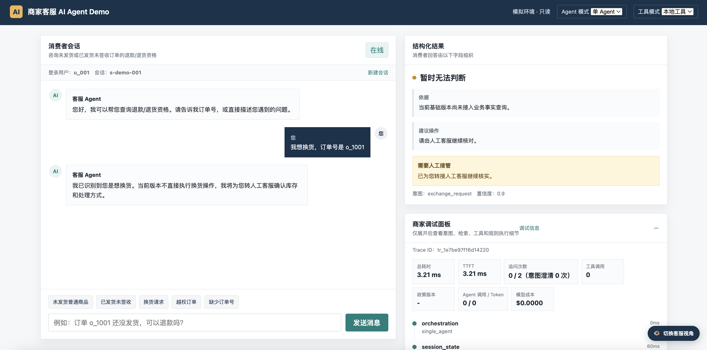

# 电商商家客服 AI Agent Demo

一个面向电商售后场景的客服 AI Agent **学习型原型**，用来拆解和演示 RAG、工具调用、多轮对话、记忆管理、MCP 和多 Agent 编排这六块核心能力。

项目使用模拟数据，全链路只读，不连接真实订单系统，不执行退款等写操作。

---

## 这个项目是什么

很多 AI Agent 教程要么停在"能聊天"的层面，要么直接上生产级复杂度。这个 demo 试图填补中间那一段：

- **一个具体的业务场景**（退款/退货/物流/换货咨询），而不是通用问答
- **每一层能力都可以独立观察**：RAG 检索了什么、调用了哪些工具、工具返回什么、决策规则怎么命中
- **单 Agent vs 多 Agent 可以直接对比**，用同一份评测集，看延迟和准确率有什么差异
- **MCP vs 本地工具可以直接对比**，量化"标准化接入"的成本

---

## 功能演示

Demo 界面支持三种视角切换（右下角按钮）：

| 视角 | 内容 |
|---|---|
| 开发者视角 | 完整 trace、工具调用时间线、RAG 命中片段、Agent 调用次数 |
| 客服视角 | AI 辅助建议面板、订单信息、转人工提示 |
| 消费者视角 | 全宽对话界面，口语化快捷回复 |



---

## 已实现的能力

| 能力 | 说明 |
|---|---|
| 意图识别 | 退款资格 / 退款进度 / 物流查询 / 换货 / 政策 FAQ |
| RAG 知识库检索 | 退款政策、物流 FAQ、商品规则、售后规范 |
| 工具调用 | 查订单 / 查物流 / 查售后，含权限校验和只读约束 |
| 多轮对话 | 槽位填充、指代消解、订单切换、会话终态管理 |
| 长期记忆 | 尺码偏好写入 / 召回 / 删除 / 90天 TTL |
| 多 Agent 编排 | 编排 / 政策 / 事实 / 转人工四角色，可与单 Agent 对比 |
| MCP 工具集成 | stdio 协议 server/client，可与本地工具模式对比 |
| 可观测性 | 每轮请求生成完整 trace，含工具入参出参和延迟 |
| 自动评测 | 40 案例 / 79 轮多轮评测集，含意图 / 槽位 / 工具路径 / 转人工指标 |

---

## 对比实验数据

### 单 Agent vs 多 Agent（评测集：40 案例 / 79 轮）

两种模式质量指标完全一致（结果一致性 100%），延迟差异来自 Agent 角色调度开销：

| 指标 | 单 Agent | 多 Agent |
|---|---|---|
| 意图准确率 | 77.2% | 77.2% |
| 工具路径准确率 | 54.1% | 54.1% |
| 转人工召回率 | 82.4% | 82.4% |
| 平均每轮延迟 | 0.26ms | 0.33ms（+27%） |
| Agent 角色调用次数 | 0 | 185 |

> 当前为确定性 mock 角色，未调用真实模型。延迟差距在接入 LLM 后会被显著放大。详见 [docs/单多Agent对比报告.md](docs/单多Agent对比报告.md)。

### 本地工具 vs MCP（5 个场景）

| 场景 | 工具调用次数 | 本地 | MCP |
|---|---|---|---|
| 未发货退款 | 3 | 2.72ms | 286ms |
| 已发货未签收 | 3 | 1.11ms | 291ms |
| 越权订单 | 1 | 0.28ms | 102ms |
| 缺少订单号 | 0 | 0.18ms | 0.30ms |
| 平均 | — | 1.07ms | 195ms（**~180×**） |

> 每次 MCP 工具调用约 100ms（子进程启动 + JSON-RPC 握手），无工具调用时两者持平。详见 [docs/MCP本地工具对比报告.md](docs/MCP本地工具对比报告.md)。

---

## 本地启动

```bash
# 1. 安装依赖
python3 -m venv .venv
source .venv/bin/activate      # Windows: .venv\Scripts\activate
pip install -e '.[dev]'

# 2. 配置环境（当前 mock 模式无需填 API key）
cp .env.example .env

# 3. 启动服务
uvicorn customer_agent.api:app --reload
```

浏览器访问 `http://127.0.0.1:8000` 打开交互式 Demo。

**也可以双击 `demo.html` 离线预览**（走前端 fallback 模拟数据，不调用后端）。

### 可选开关

| 环境变量 | 默认值 | 说明 |
|---|---|---|
| `MULTI_AGENT_ENABLED` | false | 启用多 Agent 编排模式 |
| `MCP_ENABLED` | false | 工具调用走 MCP 协议 |
| `REQUEST_TIMEOUT_SECONDS` | 8 | 单次请求超时秒数 |

---

## 运行评测

```bash
# 全量测试（42 条）
python -m pytest

# 多轮对话评测（40 案例 / 79 轮）
PYTHONPATH=src python -m evals.runner \
  --dataset data/multiturn_eval_v1.json \
  --report reports/baseline.json

# 单 Agent vs 多 Agent 对比
PYTHONPATH=src python -m evals.compare_agent_modes \
  --dataset data/multiturn_eval_v1.json \
  --report reports/agent_mode_comparison.json
```

---

## 项目结构

```
├── src/customer_agent/
│   ├── orchestrator.py     # 核心编排逻辑
│   ├── agents.py           # 多 Agent 角色定义
│   ├── session.py          # 会话状态管理 + 意图分类
│   ├── memory.py           # 长期记忆存储
│   ├── rag/                # RAG 检索（chunker + vector store + retriever）
│   ├── tools/              # 本地工具 + MCP server/client
│   └── decision/           # 退款资格规则决策
├── data/
│   ├── knowledge/          # 知识库（退款政策、物流FAQ、商品FAQ）
│   ├── orders.json         # 模拟订单数据
│   ├── logistics.json      # 模拟物流数据
│   └── after_sales.json    # 模拟售后数据
├── docs/
│   ├── 单多Agent对比报告.md
│   ├── MCP本地工具对比报告.md
│   ├── 跨层分数变化表.md
│   └── 技术架构.md
├── tests/                  # 42 条测试
├── evals/                  # 评测runner和指标计算
├── demo.html               # 前端交互界面（可离线预览）
└── 学习路径.md              # 分层学习路径和进入标准
```

---

## 设计原则

**只读，不执行写操作。** Agent 可以查订单、查物流、查售后，但不能退款、改单、发券。所有需要写操作的流程都生成草稿交由人工确认。

**有兜底，不硬答。** 以下情况一律转人工：数据缺失或冲突、特殊商品、金额争议、工具连续失败、意图置信度持续低于阈值。

**可观测，不是黑盒。** 每次请求生成完整 trace，记录意图、工具调用路径、策略命中和延迟，支持自动评测。

---

## 已知限制

- 所有数据均为模拟数据，不代表真实平台规则
- RAG 使用基于词频的余弦相似度，无语义向量，对同义词不敏感
- 多 Agent 角色为确定性 mock，未调用真实 LLM
- 不支持图片、语音等多模态输入
- 仅支持中文

---

## 学习路径

如果你想通过这个项目系统学习 AI Agent 开发，参考 [学习路径.md](学习路径.md)，包含分层能力目标、必答题和进入下一层的验收标准。

---

## License

MIT
